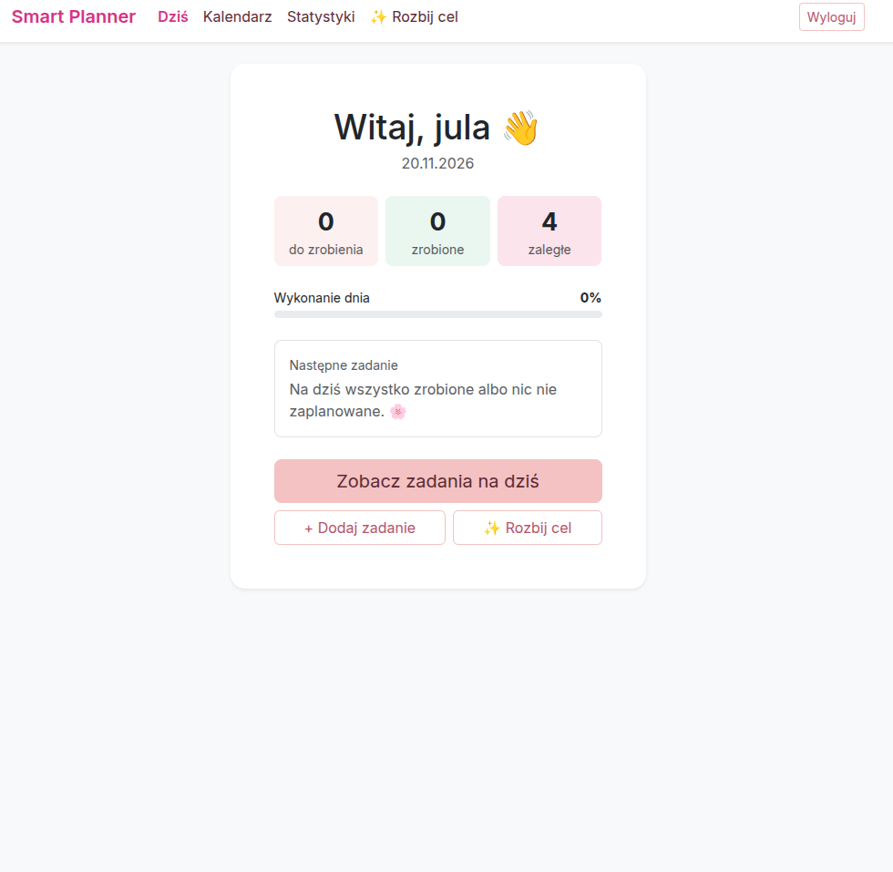
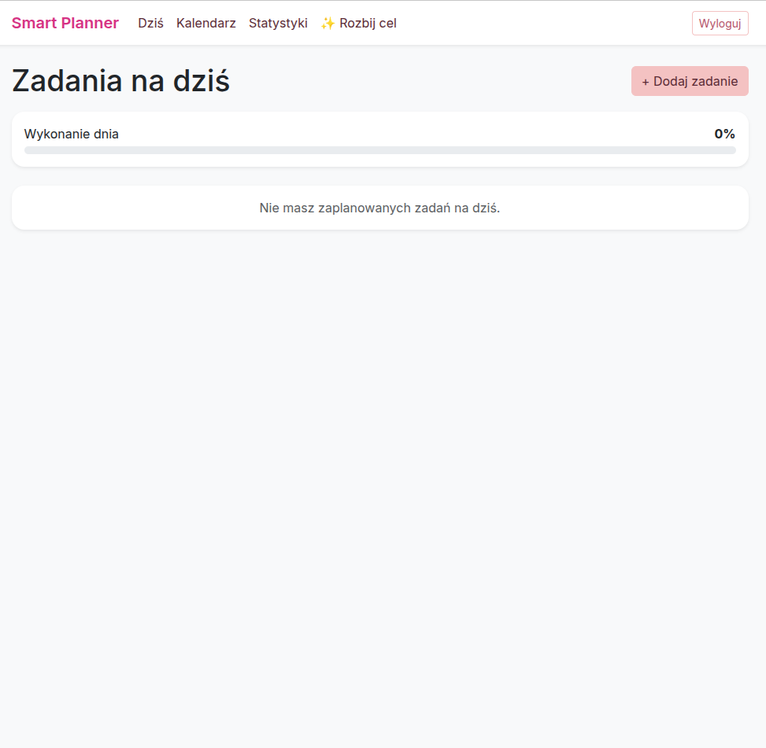
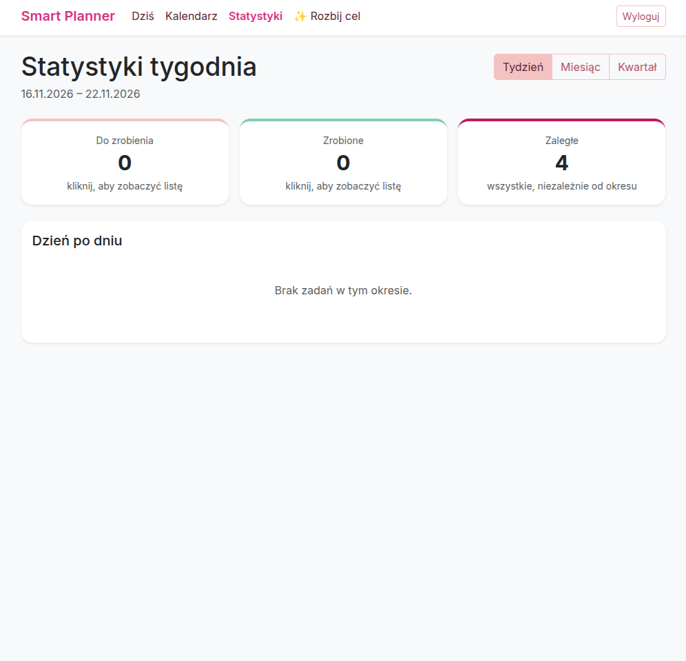
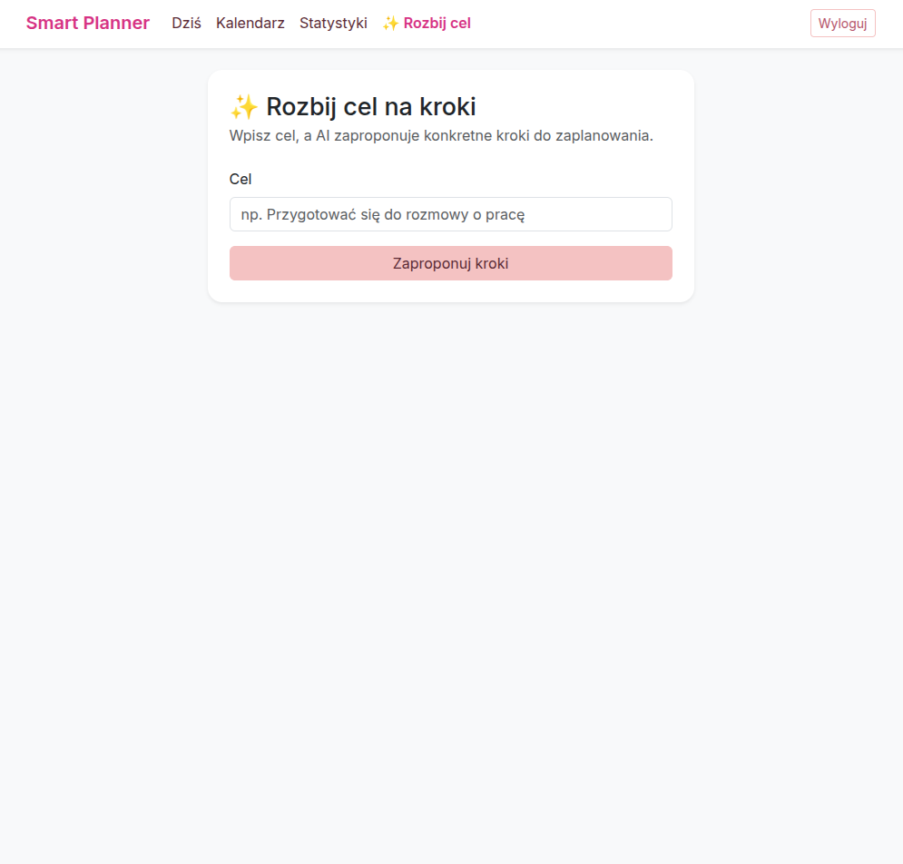

# Smart Planner

A Django web app for planning your day: schedule tasks with times and priorities, see them on a calendar, track your progress with statistics, and let AI break a big goal into small, plannable steps.

> The user interface is in **Polish**.

<!-- Replace with your own screenshots, saved in docs/screenshots/ -->
| Home | Today's tasks |
|---|---|
|  |  |

| Statistics | AI goal breakdown |
|---|---|
|  |  |

## Features

- **Daily plan**: tasks with a start time, duration, deadline, priority and category, plus a live "current time" line during the day.
- **Day summary on the home page**: tasks to do, done and overdue, today's completion rate, and the next task.
- **Priorities and categories**: colour-coded priorities and custom categories with your own colours.
- **Overlap detection**: warns you when a new task clashes with one already scheduled.
- **Calendar**: monthly view with a task count on each day; click a day to see its tasks.
- **Statistics**: weekly, monthly and quarterly view of tasks to do, done and overdue. Click a tile to expand the full list. A stacked bar chart shows each day or week.
- **Backlog**: unfinished tasks whose time has already passed, ready to reschedule.
- **AI goal breakdown**: describe a goal and get 5–7 concrete steps (via the Groq API). Pick the ones you want and add them to your plan in one click.
- **User accounts**: registration and login. Each user sees only their own tasks and categories.

## Tech stack

- **Backend:** Python 3.10+, Django 5.1, SQLite
- **Frontend:** Django templates, Bootstrap 5.3, Chart.js, flatpickr (Polish date picker)
- **AI:** Groq API

## Getting started

### 1. Clone the repository

```bash
git clone https://github.com/Julbla23/smart-planner.git
cd smart-planner
```

### 2. Create and activate a virtual environment

```bash
python3 -m venv venv
source venv/bin/activate        # Windows: venv\Scripts\activate
```

### 3. Install dependencies

```bash
pip install -r requirements.txt
```

### 4. Set up environment variables

Copy the example file and fill in the values:

```bash
cp .env.example .env            # Windows: copy .env.example .env
```

| Variable | Description |
|---|---|
| `DJANGO_SECRET_KEY` | Django secret key. Generate one with:<br>`python -c "from django.core.management.utils import get_random_secret_key; print(get_random_secret_key())"` |
| `DJANGO_DEBUG` | `True` for local development, `False` in production |
| `GROQ_API_KEY` | API key for the AI goal breakdown. Get one at [console.groq.com/keys](https://console.groq.com/keys). Without it, the rest of the app works normally, but the AI feature returns no steps. |

### 5. Create the database

```bash
python manage.py migrate
```

### 6. Run the development server

```bash
python manage.py runserver
```

Open <http://127.0.0.1:8000>, create an account and start planning.

## How tasks are counted

- **To do**: unfinished tasks planned for the selected period, whose day and deadline have not yet passed.
- **Done**: tasks marked as done during the selected period.
- **Overdue**: all unfinished tasks whose planned day or deadline has already passed, regardless of the selected period.

## Project structure

```
smart_planner/            # project settings and main URL configuration
planner/                  # the application
├── ai.py                 # Groq API integration (goal breakdown)
├── forms.py              # task and goal forms
├── models.py             # Task, Category, TaskMoveHistory
├── urls.py
├── views.py
├── static/
│   ├── css/              # day axis styles
│   └── js/               # current-time line, statistics chart
└── templates/
    ├── base.html         # layout, navigation, colours, date picker
    ├── planner/          # page templates
    └── registration/     # login page
```

## Security

- Every query is filtered by the logged-in user, so users can only see and edit their own data.
- Actions that change data (mark as done, delete, add category) use POST requests protected by CSRF tokens.
- Secret keys are kept in a `.env` file, which is excluded from the repository.

## Planned improvements

- Online deployment

## Author

**Julia Blaumann** · [GitHub](https://github.com/Julbla23) · [LinkedIn](https://www.linkedin.com/in/julia-blaumann)